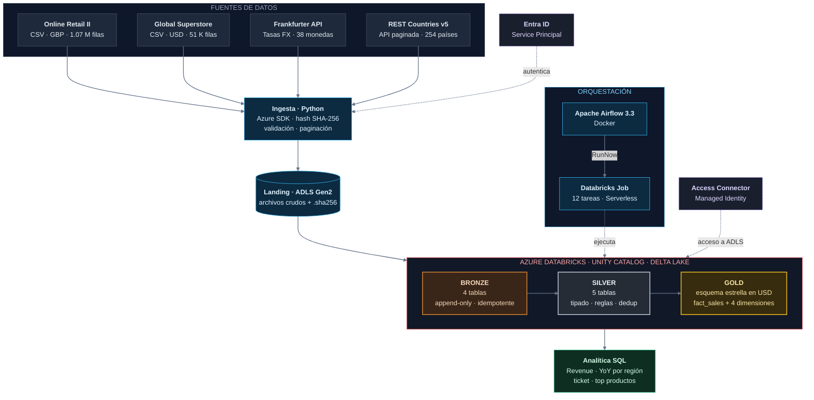
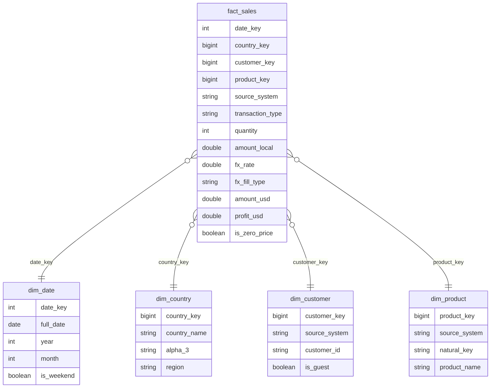

# Global Sales Lakehouse
 


 
Lakehouse de ventas globales sobre **Azure + Databricks** con arquitectura **Medallion** (Landing → Bronze → Silver → Gold). Integra cuatro fuentes heterogéneas (dos CSV y dos APIs públicas) con monedas, claves y convenciones distintas, y las unifica en un **modelo estrella** con importes convertidos a USD usando la tasa de cambio **del día de cada venta**. La ejecución está orquestada con un **job de Databricks** de 12 tareas, disparado desde **Apache Airflow**.
 
| | |
|---|---|
| **Fuentes integradas** | 4 (CSV en GBP, CSV en USD, API de tasas de cambio, API de países) |
| **Filas en la tabla de hechos** | 1,073,523 líneas de transacción |
| **Tablas** | 4 Bronze · 5 Silver · 6 Gold |
| **Orquestación** | Airflow 3.3 → job de Databricks de 12 tareas, ~2 min por ejecución |
| **Decisiones de diseño documentadas** | 53, en [`docs/decisions.md`](docs/decisions.md) |
| **Fallos silenciosos detectados y corregidos** | 3, ninguno producía un error |
 
---
 
## Arquitectura
 

 
1. **Ingesta.** Scripts de Python suben los CSV y las respuestas de las APIs, sin modificar, al contenedor `landing` de ADLS Gen2, junto con un hash SHA-256 de cada archivo. Se autentican con un Service Principal de Entra ID.
2. **Procesamiento.** Un job de Databricks Serverless lee `landing` y construye las tres capas como **tablas Delta externas** gobernadas por Unity Catalog, cada capa en su propio contenedor.
3. **Orquestación.** Airflow, en Docker, dispara el job con `DatabricksRunNowOperator`. Dentro de Databricks, el job resuelve las dependencias entre tablas y ejecuta en paralelo todo lo que puede.
4. **Consumo.** Consultas SQL sobre el modelo estrella responden las métricas de negocio.
### Stack
 
| Capa | Tecnología |
|---|---|
| Almacenamiento | Azure Data Lake Storage Gen2 · Delta Lake |
| Procesamiento | Azure Databricks (Serverless) · PySpark · Spark SQL |
| Gobierno | Unity Catalog · Storage Credential · External Locations |
| Seguridad | Entra ID (Service Principal) · Managed Identity (Access Connector) · Azure Key Vault · RBAC |
| Orquestación | Databricks Jobs · Apache Airflow 3.3 en Docker |
| Ingesta | Python · Azure SDK (`azure-identity`, `azure-storage-file-datalake`) · `requests` |
| Control de versiones | Git · GitHub · Databricks Git folders |
 
---
 
## Fuentes de datos
 
| Fuente | Contenido | Formato | Moneda | Periodo |
|---|---|---|---|---|
| [Online Retail II](https://archive.ics.uci.edu/dataset/502/online+retail+ii) (UCI) | Transacciones de un mayorista en línea del Reino Unido | CSV, 1,067,371 filas | GBP | 2009-12-01 → 2011-12-09 |
| Global Superstore (Kaggle) | Órdenes de una cadena minorista global | CSV, 51,290 filas | USD | 2011-01-01 → 2014-12-31 |
| [Frankfurter](https://www.frankfurter.app/) | Tasas de cambio históricas, base USD | JSON | — | Rango completo de ambas fuentes |
| [REST Countries v5](https://restcountries.com/) | Códigos ISO, región, continentes y monedas | JSON paginado, 254 países | — | — |
 
---
 
## Capas
 
### Landing: el archivo tal como llegó
- Cada archivo se sube con un archivo `.sha256` que registra su hash.
- **REST Countries:** paginación guiada por `meta.more`, verificación contra `meta.total` y un límite de iteraciones contra bucles infinitos. Cada respuesta se valida antes de subirse, porque la API puede devolver un error con código `200 OK` (ver *Calidad de datos*).
- **Frankfurter:** una sola llamada al endpoint de series de tiempo cubre todo el rango histórico.
### Bronze: crudo, append-only e idempotente
- Columnas de auditoría por fila: `_ingestion_timestamp`, `_source_file` y `_source_hash`.
- **Idempotencia:** antes de cargar, se busca en la tabla el mismo archivo con el mismo hash. Volver a ejecutar la ingesta no duplica datos, y un archivo corregido con el mismo nombre (hash distinto) sí se carga.
- **Lectura estricta de CSV** (`mode=FAILFAST`, `escape='"'`): una fila que no encaja en el schema detiene la carga en lugar de convertirse en `NULL` sin aviso.
### Silver: tipado, reglas de negocio y deduplicación
- **Clasificación de transacciones** de Online Retail en `transaction_type` (`sale`, `cancellation`, `fee_or_charge`, `fee_reversal`, `internal_adjustment`, `gift_voucher`, `manual_adjustment`, `unclassified`), a partir de patrones encontrados en el EDA. Solo se excluyen los errores confirmados y los datos de prueba.
- **Deduplicación** según la clave natural de cada fuente: `Row_ID`, `(rate_date, currency)`, `uuid`, o la combinación completa de columnas de negocio cuando no hay clave.
- **Aplanado** de las estructuras anidadas de REST Countries.
- **Tabla de alias** que reconcilia nombres de país entre fuentes (`EIRE` → `Ireland`, `USA` → `United States`, `Swaziland` → `Eswatini`, ...).
### Gold: modelo estrella en USD
 

 
**Grano de `fact_sales`:** una fila por línea de transacción, de cualquiera de las dos fuentes (1,022,233 de Online Retail y 51,290 de Superstore).
 
**Conversión de moneda con la tasa del día.** `daily_rates` construye una tasa para cada día del calendario. Frankfurter solo publica en días hábiles, así que los fines de semana y feriados heredan la última tasa disponible (*forward fill* con `last_value(..., ignore nulls)`). `fx_fill_type` indica si cada tasa fue publicada ese día o heredada. Un `JOIN` exacto por fecha habría dejado sin tasa las ventas de fin de semana, sin generar ningún error.
 
**Convenciones del modelo:**
 
| Convención | Por qué |
|---|---|
| Ventas y cancelaciones en la misma tabla, con importes con signo | Mismo grano y mismas dimensiones; `SUM(amount_usd)` da ventas netas sin `UNION` |
| Claves sustitutas con `xxhash64` | Deterministas: la misma entidad recibe la misma clave aunque la tabla se reconstruya |
| `source_system` dentro de las claves de cliente y producto | Un mismo ID puede existir en ambas fuentes y representar entidades distintas |
| Miembro desconocido `-1` en cada dimensión | Las ventas sin entidad resuelta no se pierden en un `INNER JOIN` |
| `NULL`, no `0`, en medidas que una fuente no tiene | `profit_usd` no existe en Online Retail; un `0` sesgaría los promedios |
| Banderas `is_zero_price`, `is_guest`, `fx_fill_type` | Hacen visibles las decisiones de modelado en lugar de esconderlas en el número |
| Liquid clustering por `date_key` | Con ~1 M de filas, particionar por día crearía 1,857 particiones diminutas |
 
---
 
## Orquestación
 
**Dos niveles.** Databricks orquesta lo que corre en Databricks, y Airflow orquesta entre sistemas.
 
- **Job de Databricks (`gsl_medallion_pipeline`):** 12 tareas, una por tabla, con dependencias declaradas a partir de los `FROM` y `JOIN` de cada DDL. Las tareas independientes corren en paralelo, y si una falla, *Repair run* relanza solo esa tarea y sus dependientes. La ejecución completa tarda alrededor de 2 minutos.
- **DAG de Airflow (`gsl_pipeline`):** dispara el job y espera su resultado, con timeout y un reintento diferido.
```python
DatabricksRunNowOperator(
    task_id="run_medallion_job",
    databricks_conn_id="databricks_default",
    job_id=MEDALLION_JOB_ID,
    execution_timeout=timedelta(minutes=30),
    retries=1,
    retry_delay=timedelta(minutes=5),
)
```
 
Los reintentos son seguros porque **cada paso es idempotente**: Bronze verifica el hash antes de cargar, y Silver y Gold se reconstruyen con `CREATE OR REPLACE`. El timeout existe por una razón concreta: una falla transitoria de Serverless dejó tareas colgadas durante más de 20 minutos sin marcar error, y una tarea colgada nunca se reintenta.
 
---
 
## Calidad de datos: fallos silenciosos
 
Los tres casos más importantes del proyecto no generaron ningún error. Se detectaron con validaciones de conteo por columna y de conciliación entre capas.
 
| Hallazgo | Impacto | Cómo se detectó | Resolución |
|---|---|---|---|
| Fechas de Superstore en formato `dd-MM-yyyy` | Al leerlas como `DATE`, las 51,290 fechas quedaron en `NULL` | `COUNT(Order_Date)` = 0 | Se leen como texto en Bronze y se convierten en Silver con `to_date` |
| Comillas escapadas como `""` en nombres de producto (`24"" Deep`) | 300 filas desalineadas: `Sales` en `NULL`, y `Profit` y `Shipping_Cost` con valores de otras columnas | Conteo de nulos por columna en Bronze, comparación contra el CSV crudo | `escape='"'` y `mode=FAILFAST` en la lectura |
| REST Countries v3.1 deprecada | La API respondió `200 OK` con un mensaje de error, que se ingirió como si fuera un dato | Inspección de la tabla Bronze | Migración a v5 y validación de la estructura antes de subir |
 
Otros casos resueltos:
 
- **`Product_ID` compartido por productos distintos** en Superstore (457 IDs, por ejemplo `Motorola Office Telephone` y `Motorola Moto X`). Se resolvió con la clave natural `(Product_ID, Product_Name)`.
- **Varias descripciones por `StockCode`** en Online Retail (773 códigos) y **variantes de mayúsculas** (170 códigos). Se resolvieron con SCD Tipo 1, la descripción más frecuente con desempate determinista, y normalización con `UPPER(TRIM())`.
- **Nombres de país distintos entre fuentes.** Se resolvieron con la tabla de alias, verificando los destinos por código ISO para no confundir los dos Congos.
**Validaciones aplicadas en cada reconstrucción:** grano de `fact_sales` contra Silver, claves resueltas a `-1`, conciliación de importes Gold contra Silver al centavo, y dirección de la conversión de moneda (factor promedio de 1.578 USD por GBP, coherente con 2009–2011).
 
---
 
## Análisis
 
Consultas en [`sql/analytics/`](sql/analytics/):
 
| Métrica | Decisión clave |
|---|---|
| **Revenue diario y mensual** | La serie diaria parte de `dim_date` con `LEFT JOIN`, así que los días sin ventas aparecen en cero en lugar de desaparecer (1,857 días) |
| **Crecimiento por región** | Contra el **mismo mes del año anterior**, por fuente. Online Retail solo tiene un año calendario completo, y comparar mes contra mes anterior arrastra estacionalidad |
| **Ticket promedio** | Total entre órdenes distintas, no promedio por línea: **780 USD** en Online Retail (mayorista) y **505 USD** en Superstore |
| **Top productos** | Revenue **neto**, top 5 por fuente con `QUALIFY` |
 
**Por qué los rankings usan revenue neto.** En el ranking bruto, `PAPER CRAFT, LITTLE BIRDIE` aparecía en el top 5 con 264,290 USD. Todo provenía de una sola factura de 80,995 unidades, cancelada el mismo día. El revenue neto la compensa con la fila de cancelación.
 
---
 
## Decisiones de diseño
 
Las 53 decisiones, con alternativas descartadas y razones, están en [`docs/decisions.md`](docs/decisions.md). Algunas representativas:
 
| Decisión | Alternativa descartada | Razón |
|---|---|---|
| Tablas Delta externas, un contenedor por capa | Tablas administradas | Separación física de capas y control de ubicación |
| Idempotencia por nombre de archivo + hash | Solo nombre de archivo | Un archivo corregido con el mismo nombre debe cargarse; uno idéntico, no |
| Identidad administrada para Databricks, Service Principal para scripts locales | Una sola identidad | Consumidores distintos; la identidad administrada no requiere rotar secretos |
| Fechas como texto en Bronze | Declarar el formato en la lectura | Si el parseo falla, el dato original sigue disponible |
| Productos de Superstore con clave `(ID, nombre)` | Nombre más frecuente por ID | Un ID compartido fusionaría ventas de productos distintos |
| `region` para agrupar geográficamente | Tabla puente país-continente | Totales aditivos; los países transcontinentales no se cuentan dos veces |
| Dos niveles de orquestación | Una tarea de Airflow por tabla | Paralelismo nativo, *repair run* y menos llamadas a la API |
| Airflow en Docker local | Airflow administrado en Azure | Sin costo fijo, dentro de un presupuesto de estudiante |
 
---
 
## Costo
 
El proyecto se construyó con una suscripción **Azure for Students**, con un presupuesto mensual de 20 USD y alertas al 80 % y al 100 %.
 
- Casi todo el gasto es cómputo de Databricks. El almacenamiento de todas las capas costó **0.04 USD**.
- No hay costo de fondo: el gasto solo aparece en los días de trabajo, porque todo el cómputo es Serverless y bajo demanda.
- Medidas aplicadas: Airflow local en lugar de administrado, *Repair run* en lugar de reejecuciones completas y timeout en la orquestación para que una tarea colgada no consuma cómputo indefinidamente.
---
 
## Estructura del repositorio
 
```
global-sales-lakehouse/
├── airflow/                 # Dockerfile, docker-compose y dependencias de Airflow
├── dags/                    # DAG de Airflow que dispara el job de Databricks
├── docs/                    # Registro de decisiones de diseño
├── notebooks/               # EDA de cada dataset e ingesta a Bronze
├── reference/               # Material de referencia de las fuentes
├── sql/
│   ├── silver/              # DDL de Silver (notebooks de Databricks)
│   ├── gold/                # DDL del modelo estrella (notebooks de Databricks)
│   └── analytics/           # Métricas de negocio
├── src/
│   ├── common/              # Configuración desde variables de entorno
│   └── ingestion/           # Subida a landing, clientes de API, lectura a Bronze
└── requirements.txt
```
 
---
 
## Cómo ejecutarlo
 
**Requisitos:** suscripción de Azure, workspace de Azure Databricks Premium con Unity Catalog, Docker Desktop y Python 3.
 
1. **Infraestructura de Azure:** cuenta de ADLS Gen2 con contenedores `landing`, `bronze`, `silver` y `gold`; Key Vault; Service Principal con `Storage Blob Data Contributor` sobre la cuenta; Access Connector con el mismo rol.
2. **Unity Catalog:** Storage Credential con el Access Connector y una External Location por contenedor.
3. **Variables de entorno:** un `.env` en la raíz con las credenciales del Service Principal, la API key de REST Countries y la conexión de Airflow a Databricks (`AIRFLOW_CONN_DATABRICKS_DEFAULT`).
4. **Subir las fuentes a landing:**
```bash
pip install -r requirements.txt
python -m src.ingestion.upload_to_landing
python -m src.ingestion.fetch_frankfurter
python -m src.ingestion.fetch_rest_countries
```
5. **Databricks:** clonar el repo como Git folder y crear el job `gsl_medallion_pipeline` con un notebook por tabla de `sql/silver/` y `sql/gold/`, más `notebooks/run_bronze_ingestion`.
6. **Airflow:**
```bash
cd airflow
docker compose build
docker compose up -d
```
   Abrir `http://localhost:8080`, activar `gsl_pipeline` y dispararlo.
 
---
 
## Limitaciones conocidas
 
- **`Korea` → `South Korea`:** Online Retail no distingue entre las dos Coreas; la asignación es una suposición.
- **Cuatro "países" sin equivalente** (`Channel Islands`, `Unspecified`, `European Community`, `West Indies`; 2,497 filas) se agrupan en `Unmapped` en lugar de recibir un código inventado.
- **Productos de Online Retail agrupados por código:** unos pocos códigos podrían agrupar productos distintos (por ejemplo, `85014A`).
- **Cancelaciones sin referencia a la venta original:** cada devolución cuenta en su propia fecha.
- **La ingesta a landing se ejecuta fuera de Airflow:** el DAG orquesta el procesamiento en Databricks; la subida de archivos se lanza desde los scripts locales.
 